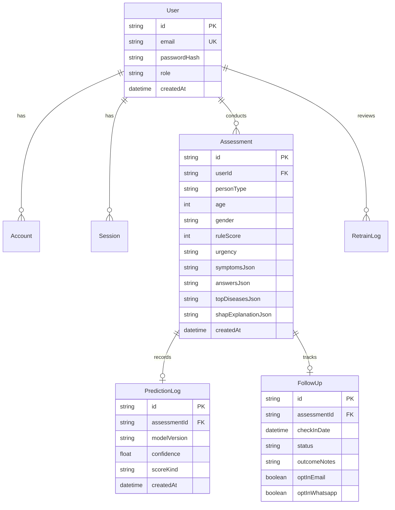

# SymptoSense — Comprehensive Project Technical Specification & Data Dossier

**Document Version:** 1.0.0  
**Project:** SymptoSense — ML-Based Symptom Triage and Clinical Decision Support System  
**Last Updated:** October 2026  
**License / Proprietary Status:** Prototype Research & Triage Decision-Support Platform  

---

## 1. Executive Summary

**SymptoSense** is a modern, privacy-focused symptom-triage and disease-likelihood estimation web platform. Built with **Next.js (React 19, TypeScript)**, **Prisma**, and a high-performance **Python FastAPI Machine Learning microservice**, the platform allows users to self-report or assess symptoms on behalf of family members using structured questionnaires, adaptive dynamic questions, and voice input in **English, Hindi, and Marathi**.

### Core Value Proposition
- **Multi-Tier Triage**: Integrates deterministic clinical safety red-flag rules with supervised Machine Learning classifiers (Random Forest, XGBoost) and large language model (LLM) reasoning.
- **Fail-Safe Clinical Prioritization**: Zero-latency red-flag overrides ensure critical medical emergencies (e.g., myocardial infarction, stroke signs, severe respiratory distress) are immediately classified as High Urgency, bypassing lower ML statistical predictions.
- **Explainable Predictions**: Combines **SHAP (SHapley Additive exPlanations)** feature attribution with curated medical precautions verified against clinical corpora.
- **Non-Diagnostic Stated Boundary**: Clear medical disclaimers reinforce that SymptoSense provides educational triage indicators and risk scoring, **not formal clinical diagnosis**.

---

## 2. Multi-Tier Hybrid Medical Architecture

```
                    User Symptom Input (Voice / Dynamic Questionnaire)
                    Context: Age, Sex, Duration, Severity, Medical History
                                            │
                                            ▼
    ┌───────────────────────────────────────────────────────────────────────────┐
    │  TIER 1: Deterministic Clinical Safety & Emergency Rule Engine             │
    │  - Zero-latency rule evaluation for danger signs / red flags               │
    │  - Regex / canonical dictionary matching with negation handling           │
    │  - Score range: 0–100 (Medium: >= 28, High: >= 55)                        │
    │  - Overrides score to 100/High upon detecting emergency indicators        │
    └───────────────────────────────────────────────────────────────────────────┘
                                            │
                                            ▼
    ┌───────────────────────────────────────────────────────────────────────────┐
    │  TIER 2: Supervised Machine Learning Disease Classifiers                  │
    │  ├─ Tier 2A: Primary Care Outpatient Model (Random Forest)                │
    │  │   • 41 Common Medical Conditions (4,920 records, 131 natural symptoms) │
    │  │   • Calibrated probability estimates + SHAP top-5 feature attribution  │
    │  │   • 4-step verified clinical precautions and disease descriptions      │
    │  ├─ Tier 2B: DDXPlus Benchmark Model (XGBoost / Calibrated Classifier)    │
    │  │   • 49 Pathology classes across 980 demographic & evidence tokens      │
    │  │   • Selective prediction operating points (Precision ~90%, Cov ~50%)   │
    │  └─ Tier 2C: SymCat Bayesian Reference Engine (801 Pathologies Lookup)     │
    └───────────────────────────────────────────────────────────────────────────┘
                                            │
                                            ▼
    ┌───────────────────────────────────────────────────────────────────────────┐
    │  TIER 3: Medical LLM Reasoning & Multilingual Orchestration (Groq / Llama)│
    │  - Generates adaptive follow-up questions tailored to ambiguous inputs     │
    │  - Multilingual voice synthesis & translation (Sarvam AI / Web Speech)     │
    │  - Synthesizes patient-friendly explanations without altering fixed urgency│
    └───────────────────────────────────────────────────────────────────────────┘
                                            │
                                            ▼
    ┌───────────────────────────────────────────────────────────────────────────┐
    │  AUTHORITATIVE BACKEND PERSISTENCE & MONITORING                           │
    │  - Server recalculates all scores on completion (rejects forged client ml)│
    │  - Immutable assessment record, version hashes, outcome follow-up check-in│
    │  - ML Retraining gate with human-in-the-loop review criteria               │
    └───────────────────────────────────────────────────────────────────────────┘
```

---

## 3. Technology Stack Breakdown

| Layer | Technologies & Libraries | Functionality |
| :--- | :--- | :--- |
| **Frontend Framework** | **Next.js 15.3.1**, **React 19**, **TypeScript 5** | App router, Server-Side Rendering (SSR), Server Actions, responsive UX |
| **Styling & UI** | **Tailwind CSS 4**, **Radix UI**, **Lucide React**, **Framer Motion** | Glassmorphic design, accessible modals, animations, responsive layouts |
| **Data Visualization**| **Recharts 3.8.0** | ML insights dashboard, confusion matrices, calibration curves, risk gauges |
| **Authentication** | **NextAuth.js 4.24.11**, **bcryptjs** | Credentials provider, JWT sessions, optional Google OAuth provider |
| **Database & ORM** | **Prisma 5.22.0**, **SQLite** (local dev) / **PostgreSQL** (production) | Database schema migrations, typed models, transactional writes |
| **ML Microservice** | **Python 3.14/3.11**, **FastAPI**, **Uvicorn**, **Pydantic** | Standalone inference API running on port 8000 |
| **Data Science / ML**| **Scikit-learn**, **XGBoost**, **SHAP**, **Joblib**, **NumPy**, **Pandas** | Classification models, calibration, feature importance, sparse matrix math |
| **AI / LLM Service** | **Groq SDK (Llama 3.3-70B / 3.1-8B)** | Adaptive question generation, structured medical reasoning |
| **Voice Processing** | **Sarvam AI APIs** + Native Browser Web Speech API | Multilingual Speech-to-Text (STT) and Text-to-Speech (TTS) (EN, HI, MR) |
| **Rate Limiting** | **Upstash Redis REST Pipeline** + Bounded In-Memory | Defense against DDoS/brute-force on registration and prediction APIs |

---

## 4. Machine Learning Models & Datasets

### 4.1. Model Summary Table

| Model Artifact | Algorithm | Training Corpus | Target / Output | Key Metrics |
| :--- | :--- | :--- | :--- | :--- |
| `clinical_rf_model.joblib` | **Calibrated Random Forest** | Primary Care Corpus (4,920 records) | Top-3 Diseases from 41 classes + calibrated probabilities | Macro F1 ~0.94, Multiclass Brier < 0.08 |
| `ddxplus_xgb.joblib` | **Calibrated XGBoost** | DDXPlus Synthetic Benchmark | 49 Pathologies (980 sparse features) | Top-1 Accuracy: 86.4%, Top-3 Accuracy: 96.1% |
| `confidence_model.joblib` | **Random Forest Regressor** | Synthetic Heuristic Cohort (30,000 cases) | Confidence Score (0.00 – 1.00) & Uncertainty Level | Verified across 18 clinical & survey features |
| `symcat_db.joblib` | **Bayesian Lookup Engine** | SymCat Medical Knowledge Base | Probability distribution over 801 conditions | Reference conditional likelihood |

---

### 4.2. Dataset Inventories

#### 1. Primary Care Clinical Corpus
- **Files**: `ml-service/data/dataset.csv`, `symptom_Description.csv`, `symptom_precaution.csv`
- **Volume**: 4,920 patient symptom presentations.
- **Features**: 131 standard natural language symptom indicators (`fever`, `cough`, `chest_pain`, `joint_pain`, `skin_rash`, etc.).
- **Diseases (41 Classes)**:
  - Infectious: *Malaria, Dengue, Typhoid, Tuberculosis, Chicken pox, Common Cold, Pneumonia, Hepatitis A-E*
  - Chronic/Endocrine: *Diabetes, Hypertension, Hypothyroidism, Hyperthyroidism, Hypoglycemia*
  - Gastrointestinal: *GERD, Peptic ulcer disease, Gastroenteritis, Jaundice, Alcoholic hepatitis*
  - Dermatological: *Fungal infection, Allergy, Psoriasis, Impetigo, Acne*
  - Musculoskeletal & Neurological: *Arthritis, Cervical spondylosis, Migraine, (vertigo) Paroxysmal Positional Vertigo*
- **Clinical Annotations**: Each condition is paired with verified medical descriptions and 4 direct actionable precautions.

#### 2. DDXPlus Benchmark Dataset
- **Files**: `ml-service/data/ddxplus/` (release-split benchmark)
- **Pathologies**: 49 complex clinical diagnoses.
- **Evidence Schema**: 110 distinct symptom and antecedent codes expanding to 980 binary feature tokens (incorporating values and demographic bins).
- **Perturbation Testing**: Includes seeded stochastic feature masking (`ml_pipeline/perturb.py`) to simulate realistic partial patient presentations.

#### 3. Confidence Model Dataset
- **Volume**: 30,000 synthetic patient response records.
- **Features (18 Columns)**:
  `age_group`, `severity`, `duration`, `fever`, `cough`, `chest_pain`, `dizziness`, `fatigue`, `diabetes`, `heart_disease`, `rule_score`, `risk_level`, `symptom_intensity_score`, `symptom_consistency_score`, `symptom_progression`, `answer_confidence_proxy`, `ambiguity_score`, `multi_symptom_density`.

---

## 5. Database Schema & Data Models

SymptoSense uses **Prisma ORM** with a strict relational structure:

### 5.1. Database Entities


### 5.2. Core Tables
1. **`User`**: Account identity, hashed passwords, roles (`USER`, `ADMIN`), language preference (`en`, `hi`, `mr`).
2. **`Assessment`**: Full immutable triage session record. Saves raw inputs, questionnaire answers, server-calculated rule score, primary urgency, and Top-3 predicted diseases.
3. **`PredictionLog`**: Tracks model artifact hashes, input feature vectors, inference latency, and uncertainty metrics.
4. **`FollowUp`**: Manages patient longitudinal outcome follow-ups, post-triage check-ins, and notifications.
5. **`RetrainLog`**: Admin audit trail for model retraining triggers, benchmark validations, and champion/challenger promotions.

---

## 6. API Architecture & Routing Matrix

### 6.1. Next.js Application Endpoints (Port 3000)

| Endpoint | Method | Auth | Description |
| :--- | :---: | :---: | :--- |
| `/api/auth/[...nextauth]` | `POST/GET` | None | NextAuth authentication handler (credentials login & OAuth) |
| `/api/auth/register` | `POST` | Rate-limited | User registration with bcrypt hashing (12 rounds) |
| `/api/sessions` | `GET/POST` | Required | List user assessments or initialize a draft triage session |
| `/api/sessions/[id]` | `GET/PATCH` | Required | Retrieve session details or commit server-authoritative completion |
| `/api/question-gen` | `POST` | Required | LLM-driven adaptive follow-up questions generator |
| `/api/ml/disease` | `POST` | Required | Next.js proxy to FastAPI disease prediction service |
| `/api/ml/predict` | `POST` | Required | Next.js proxy to FastAPI confidence score prediction |
| `/api/ml/clinical-report`| `GET` | Admin | Fetch model training statistics, confusion matrix & metrics |
| `/api/ml/report` | `GET` | Admin | Fetch DDXPlus benchmark reports & feature importance |
| `/api/voice/transcribe` | `POST` | Required | Audio transcription endpoint via Sarvam AI Speech-to-Text |
| `/api/voice/synthesize` | `POST` | Required | Text-to-Speech synthesis for Hindi, Marathi, and English |

---

### 6.2. Python FastAPI ML Service Endpoints (Port 8000)

| Route | Method | Payload / Params | Return Data |
| :--- | :---: | :--- | :--- |
| `/health` | `GET` | None | `{"status": "healthy", "model_loaded": true, "modelVersion": string}` |
| `/predict-disease` | `POST` | `{ symptoms: string[], age?: number, sex?: string }` | Top-3 conditions, calibrated probabilities, SHAP top-5, precautions |
| `/predict-confidence` | `POST` | `18 Feature Pydantic Payload` | `{ confidence: float, confidenceLevel: string, uncertainty: bool }` |
| `/api/retrain` | `POST` | Header: `X-Retrain-Token` | Asynchronous trigger for candidate model retraining |
| `/api/retrain/report` | `GET` | Header: `X-Retrain-Token` | Latest candidate model validation & champion comparison metrics |

---

## 7. Clinical Safety, Guardrails & Governance

1. **Negation & Denial Parsing**:
   - Both the deterministic rule engine and ML feature mapper utilize phrase-boundary tokenization and negation filters (e.g., *"no chest pain"*, *"absence of fever"*, *"नाही"*, *"नहीं"*). Negated inputs never activate disease features.
2. **Emergency Red-Flag Floors**:
   - Emergency indicators (e.g., severe chest tightness, sudden hemiparesis, shortness of breath at rest, acute confusion) trigger an immediate **100/100 score override (High Urgency)**.
   - Even if the ML model estimates a low probability for an acute event, the rule engine floor cannot be lowered by statistical inference.
3. **Selective Prediction & Operating Points**:
   - The ML inference layer computes an operating point margin. Predictions with low confidence or high entropy trigger an `uncertain: true` flag and recommend clinical consultation.
4. **Authoritative Server Recalculation**:
   - Client-side browsers calculate risk for instantaneous UI responsiveness; however, when the assessment is saved, the Next.js server **recomputes all rules from raw answers** to prevent tampering.

---

## 8. Verification, Testing & Quality Gates

The SymptoSense repository enforces strict quality assurance commands:

| Command | Target | Scope Covered |
| :--- | :--- | :--- |
| `npm run typecheck` | TypeScript Compiler (`tsc`) | Full strict type checking across all components, APIs, and libraries |
| `npm run lint` | ESLint 9 + Next.js Plugin | Code formatting, React hooks rules, and lint compliance |
| `npm test` | Node Test Runner | 36+ automated tests for scoring rules, emergency overrides, deduping |
| `npm run test:python` | Pytest (`ml-service/tests`) | 24+ Python tests for ML inference, feature contracts, edge cases |
| `npm run test:ml` | Pytest ML Pipeline | Validates data loaders, perturbation tests, and calibration metrics |
| `npm run build` | Next.js Production Build | Static route optimization and Next.js bundle compilation |

---

## 9. Local Development & Operational Status

Both application services run concurrently in local development:
- **Web Application**: Accessible at `http://localhost:3000` (Node.js dev server).
- **ML Inference Service**: Accessible at `http://127.0.0.1:8000` (FastAPI / Uvicorn server).
- **Database Engine**: Local SQLite database located at `prisma/dev.db`.
