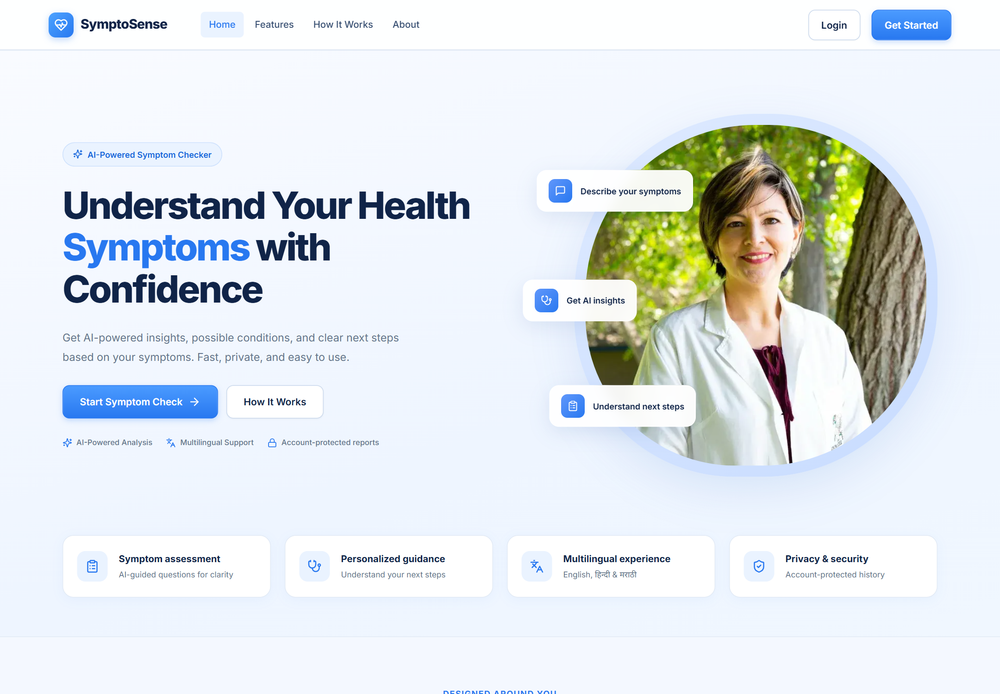
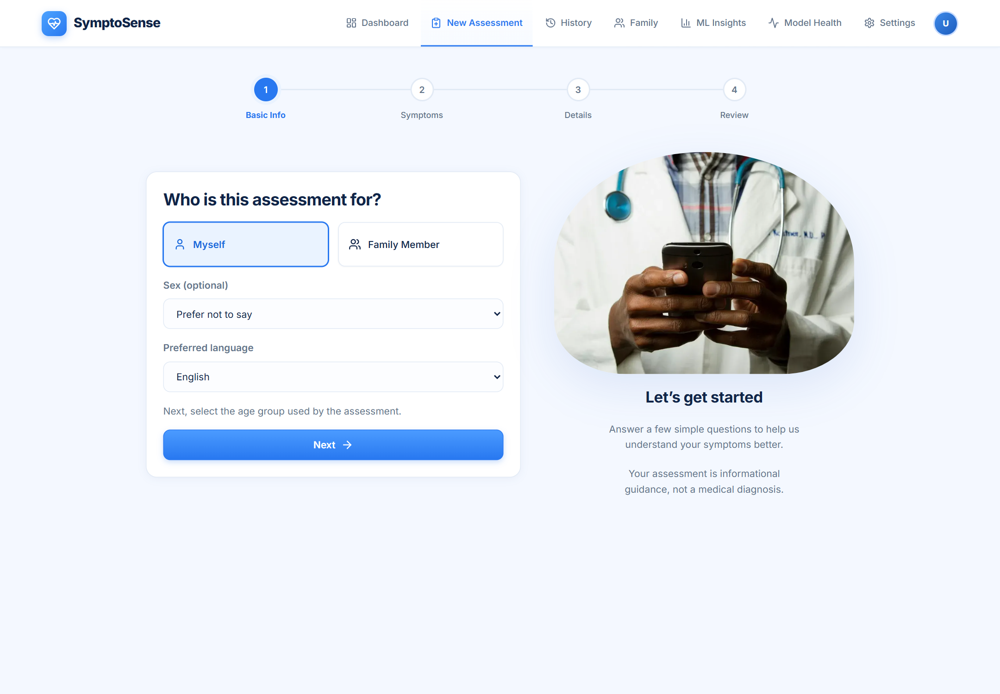
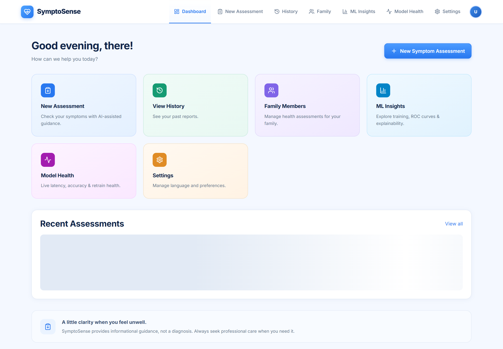
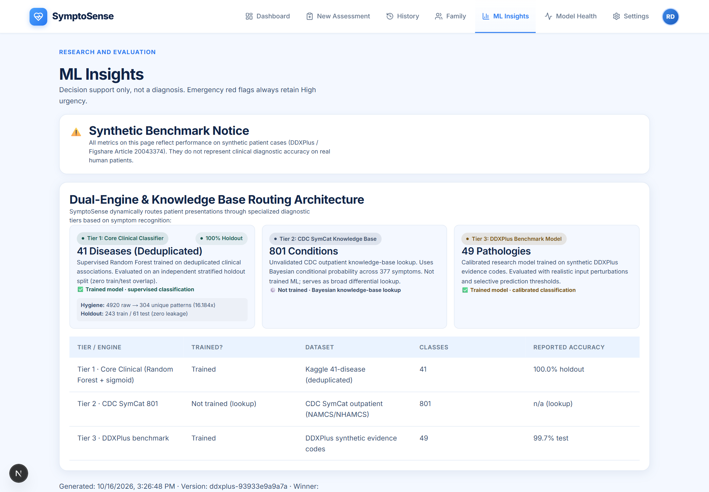
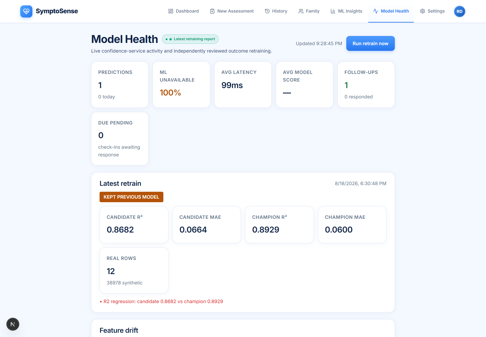
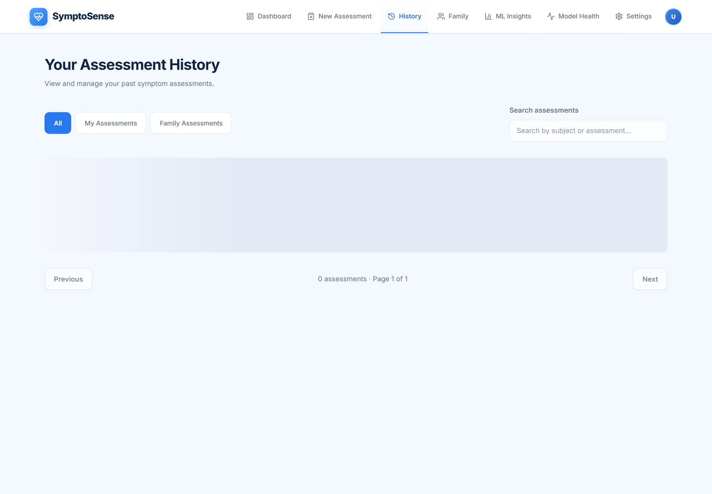
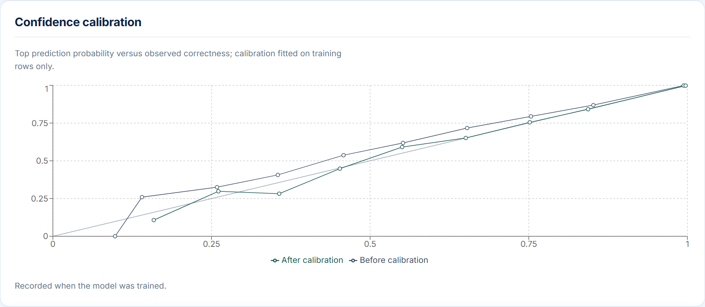
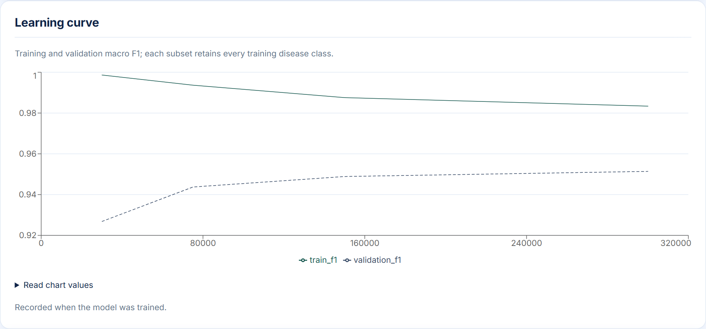
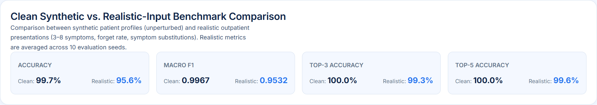

# SymptoSense

**ML-based symptom triage and disease-likelihood estimation — an educational decision-support prototype.**

[](https://github.com/taksh1507/SymptoSense/actions/workflows/verify.yml)
[](LICENSE)

SymptoSense takes a structured symptom questionnaire (English, Hindi, Marathi; voice or typed), applies a deterministic clinical red-flag rule engine, then adds explainable machine-learning disease likelihood. It supports self or family-member assessments, saved reports, and optional outcome reminders.

> **Not a medical diagnosis.** This repository is a research and engineering prototype. It does **not** establish clinical diagnostic accuracy and must not be used for real medical decisions.

| | |
| --- | --- |
| **Stack** | Next.js 15 · React 19 · TypeScript · Prisma/SQLite · FastAPI (Python 3.14) |
| **ML** | scikit-learn 1.8.0 · XGBoost 3.1.3 · SHAP |
| **AI services** | Groq (symptom extraction + prose) · Sarvam (speech/translation) |
| **CI** | GitHub Actions — lint, typecheck, 4 test suites, build, integration |

---

## Screenshots

Captured from the running application; the committed originals are under `outputs/`.

| Landing | Assessment | Results |
| --- | --- | --- |
|  |  |  |

| ML report | Model health | Reports list |
| --- | --- | --- |
|  |  |  |

| Calibration | Learning curve | Evaluation |
| --- | --- | --- |
|  |  |  |

Responsive ML Insights views and desktop explainability captures are in `outputs/ml-insights-verification/`.

---

## Key features

- **Deterministic triage first.** A 0–100 rule score with emergency red flags that override everything. Medium begins at 28, High at 55; emergency findings force the score to 100.
- **Explainable disease prediction.** Classical ML over the synthetic DDXPlus benchmark, returning class probabilities plus SHAP feature contributions.
- **Three-tier diagnostic routing.** Specialized models by presentation type (see [Architecture](#architecture)).
- **Safety-oriented failures.** Model outages return *unavailable*, never a fabricated percentage. Red-flag rules stay active even when prediction is down.
- **Private by design.** Optional vendor credentials can be left blank; every external feature degrades to a local fallback.
- **Multilingual + voice.** English, Hindi, Marathi input with speech-to-text and translation.
- **Auditable history.** Reports store the rule-engine and model version with the full assessment payload.

---

## Architecture

### Request flow

```text
Questionnaire (canonical symptoms + adaptive answers)
        │
        ▼
Deterministic rule engine ──► emergency red flags override to High
        │
        ├──► Groq extracts explicitly affirmed symptoms into the fixed vocabulary
        │        (extraction failure: continue with the questionnaire; Groq never diagnoses)
        │
        ├──► Disease inference ──► raw probabilities + SHAP
        │        Groq may explain this structured output; it cannot change urgency
        │
        ▼
Authenticated assessment API
  • recalculates the score
  • obtains optional model output with a deadline
  • atomically saves questionnaire + result + version metadata
    + linked prediction log + unique outcome check-in
        │
        ▼
Saved report (browser shows the deterministic result immediately)
```

**Scoring rules.** The browser shows the deterministic result immediately. Emergency findings override the score to 100. Other scores are capped at 100. Age is recorded and used by the legacy confidence model; age, intensity, and duration are **not** features of the disease dataset, so the disease model makes no claim to learn effects absent from its data. The current rule engine does not apply age-specific weights.

**Inference parity.** Standalone and serverless inference share `ml-service/inference.py` and `ml-service/confidence_model.joblib`. API `rule_score` is always raw 0–100 and is normalized once in Python. Historical results store their rule/model version and full assessment payload.

### Three-tier diagnostic architecture

| Tier | Coverage | Method | Status |
| --- | --- | --- | --- |
| **1** | 41 core clinical conditions | Calibrated Random Forest on deduplicated clinical symptom–disease associations (304 unique patterns from 4,920 raw rows, eliminating train/test leakage); independent holdout | Evaluates first when clinical tokens match |
| **2** | 801 CDC conditions | Literature-derived Bayesian conditional probability over 377 symptoms (CDC NAMCS/NHAMCS statistics) | **Unvalidated** broad differential lookup |
| **3** | 49 DDXPlus pathologies | Calibrated XGBoost on the synthetic DDXPlus benchmark with input perturbation and selective prediction | Benchmark tier |

---

## Quick start

**Prerequisites:** Node.js 24+, Python 3.14 (the verified CI and local environment), npm. Model artifacts require `scikit-learn==1.8.0` — use the pinned Python environment.

```bash
# 1. Configure environment (never commit the resulting .env)
cp .env.example .env
node -e "console.log(require('node:crypto').randomBytes(32).toString('hex'))"  # -> NEXTAUTH_SECRET

# 2. Install JavaScript dependencies and the database baseline
npm ci
npm run db:deploy          # fresh database; use db:adopt for an existing db push database

# 3. Python environment for the model service
python -m venv .venv
.venv\Scripts\python.exe -m pip install -r ml-service/requirements.txt   # Windows
# python -m pip install -r ml-service/requirements.txt                   # macOS/Linux

# 4. Disease artifacts (raw DDXPlus files are local-only and gitignored)
cd ml-service && python train_pipeline.py && cd ..

# 5. Run the model service and the web app
.venv\Scripts\python.exe ml-service/server.py     # binds 127.0.0.1:8000
npm run dev                                        # http://localhost:3000
```

Register with email/password. Google sign-in requires configured `GOOGLE_CLIENT_ID` and `GOOGLE_CLIENT_SECRET`.

**Database paths.** `DATABASE_URL=file:./dev.db` resolves to `prisma/dev.db`. The Python service uses the same path unless `SYMPTOSENSE_DB` overrides it. Operational database files and local backups are gitignored. The migration history was replaced with a consistent SQLite baseline because the old SQL and lockfile targeted PostgreSQL; adopt existing databases rather than resetting any that hold needed records.

### Configuration

All variables are documented in [`.env.example`](.env.example). The most important:

| Variable | Purpose |
| --- | --- |
| `NEXTAUTH_SECRET` / `NEXTAUTH_URL` | Session signing and canonical URL |
| `DATABASE_URL` | SQLite path (`file:./dev.db`) |
| `ML_SERVICE_URL` | FastAPI base URL for the model service |
| `ADMIN_EMAILS` | Comma-separated admin allowlist. **Empty denies all admin access** |
| `RETRAIN_TOKEN` | Shared secret required by retrain/report endpoints |
| `RATE_LIMIT_REST_URL` / `RATE_LIMIT_REST_TOKEN` | Redis-compatible limiter. **Production fails closed without them** |
| `SCHEDULER_DISABLED` | Reminders are off by default (`1`) |
| `GROQ_API_KEY`, `SARVAM_API_KEY` | Optional AI services; leave blank to exercise fallbacks |

---

## Testing & verification

```bash
npm run lint          # ESLint
npm run typecheck     # tsc --noEmit
npm test              # Node test runner (JS/TS)
npm run test:python   # pytest
npm run test:ml       # ML pipeline tests
npm run build         # production build
npm run test:integration   # disposable services + separate fixture database
```

All of the above run in CI on every push (`.github/workflows/verify.yml`). Tests cover canonical/multilingual/negated danger signs, all-answer scoring, feature validation, legacy and full-payload report reconstruction, voice matching, request limits, admin permissions, real model inference, deployment parity, unavailable models, migrations, reminder dates and opt-in handling, and reviewed-outcome retraining gates. Integration fixtures never use operational patient records or real notification credentials.

> The notebook step (`ml-service/execute_notebook.py`) requires the local-only DDXPlus patient data, so CI **skips it with an explicit message** rather than failing. It runs on a machine where the dataset is present.

---

## Disease ML pipeline & evaluation

Disease prediction uses the synthetic [DDXPlus dataset](https://figshare.com/articles/dataset/DDXPlus_Dataset/20043374) ([paper](https://arxiv.org/abs/2205.09148)), released under CC BY 4.0. Provenance, license-text hash, and input hashes are recorded in `ml-service/data/ddxplus/SOURCE.md` and each generated `ml_report.json`. The patient CSVs, conditions JSON, and evidence JSON are downloaded locally and ignored by Git.

**Input schema.** Patient columns: `AGE, DIFFERENTIAL_DIAGNOSIS, SEX, PATHOLOGY, EVIDENCES, INITIAL_EVIDENCE`. Evidence lists use binary codes and categorical/multichoice values (`_@_`). Metadata defines 110 symptoms and 113 antecedents. `INITIAL_EVIDENCE` is excluded because the app does not collect it. Numeric age maps to app groups Child (0–12), Teen (13–18), Adult (19–49), Elderly (50+); age 50 goes to Elderly to remove the questionnaire's overlapping boundary. Missing sex is represented as *unknown*, with 20% of training sex values masked for robustness.

**Training.** `python train_pipeline.py --train-rows 150000` uses seeded, pathology-stratified samples from the official train/validate/test splits. Training compares Logistic Regression, Multinomial Naive Bayes, Random Forest, and XGBoost with five-fold stratified CV, tunes the two CV leaders on training folds, selects by validation macro-F1, and only then evaluates the official test sample.

**Calibration is earned, not assumed.** A calibration method ships only when the report shows it improving **both** validation Brier score and log loss. The live confidence uses whichever method `ml_report.json` records.

> **No performance number is asserted in this README.** The ML Insights dashboard and `ml_report.json` are the source of the actual trained metrics — see the screenshots above.

**Urgency mapping.** DDXPlus severity is lower-number-is-more-severe. The research target maps severity 1–2 → High, 3 → Medium, 4+ → Low. These are dataset-defined synthetic labels, not clinician-validated triage. The app takes urgency as the highest of the model result, red-flag override, and disease safety floor.

> **The disease safety floors are project safety choices, not clinical guidelines.** Severity-1 Anaphylaxis, Laryngospasm, Ebola, Possible NSTEMI/STEMI, and acute pulmonary edema, plus severity-2 pulmonary embolism, unstable angina, spontaneous pneumothorax, Boerhaave, epiglottitis, Guillain–Barré, Croup, and Myocarditis raise urgency to High. PSVT, Scombroid food poisoning, acute dystonic reactions, and stable angina have a Medium floor. Red-flag findings always force High.

### API and artifacts

Authenticated app routes: `/api/ml/extract`, `/api/ml/disease`. FastAPI exposes `/predict-disease`, `/ml-report`, and `/clinical-report`. Unknown evidences are returned in the ignored list; if none are recognized the endpoint returns **422**. The notebook `ml-service/notebooks/SymptoSense_ML.ipynb` documents data, EDA, preprocessing, training, evaluation, baselines, robustness, explainability, and limitations; `python ml-service/execute_notebook.py` executes and validates it. Generated figures live in `ml-service/reports/figures/`.

---

## Training on Google Colab

[](https://colab.research.google.com/github/taksh1507/SymptoSense/blob/main/ml-service/notebooks/SymptoSense_Colab_Training.ipynb)

[`ml-service/notebooks/SymptoSense_Colab_Training.ipynb`](ml-service/notebooks/SymptoSense_Colab_Training.ipynb) trains and compiles all three tiers end to end.

- **Hardware:** GPU optional. If a CUDA GPU is detected, `DDX_XGB_DEVICE=cuda` is set automatically for XGBoost.
- **Durability:** free Colab sessions can disconnect. Keep `USE_DRIVE = True` so logs and output archives persist to `MyDrive/SymptoSense_Outputs`.
- **Output:** `symptosense_artifacts.zip` containing `ml-service/artifacts/`, `ml-service/artifacts/clinical/`, `ml-service/reports/`, `lib/ml/symptom-list.json`, and a `manifest.json` recording commit hash, Python version, pinned library versions, timestamp, row budget, and CLI flags.

```bash
# Extract artifacts at the repository root
python -m zipfile -e symptosense_artifacts.zip .          # cross-platform
unzip -o symptosense_artifacts.zip                        # Linux / macOS
Expand-Archive -Path symptosense_artifacts.zip -DestinationPath . -Force   # Windows PowerShell
```

> **Version pinning.** Joblib artifacts load reliably only under the exact training library versions, especially `scikit-learn==1.8.0` and `xgboost==3.1.3`. The notebook installs and asserts these before training.
>
> **Large files.** Trained weights and SHAP backgrounds can exceed GitHub limits. Do not commit `.joblib` files directly — use Git LFS or attach them to tagged Releases.

---

## Deployment

- **Target host requirements:** a durable writable volume for SQLite, a trusted reverse proxy, and shared rate-limit storage across instances.
- **Rate limiting:** production requires `RATE_LIMIT_REST_URL` + `RATE_LIMIT_REST_TOKEN`; requests **fail closed** when the limiter is missing or failing. Development uses bounded per-process limits. Set `TRUST_PROXY=true` only behind a proxy that overwrites forwarding headers.
- **Serverless:** `vercel.json` excludes local data and development files from the Python bundle. Serverless code parity is tested locally, but **a live Vercel deployment is not verified**. SQLite assessment storage needs a durable volume, so the full app is not deployable on ephemeral serverless storage — on Vercel, prediction can use the serverless entry point while retraining/reminders require a separately hosted persistent Python service.
- **Admin:** set `ADMIN_EMAILS` and a nonempty `RETRAIN_TOKEN`. Missing values deny access. One retraining job runs at a time; model updates verify their hash and return *unavailable* during an incomplete promotion, and reload without restarting prediction serving.
- **PostgreSQL:** migrating requires deliberately changing the schema, migration history, and Python storage layer. SQLite is the implemented provider.

---

## Retraining & outcome evaluation

The legacy confidence service is separate from the disease classifier and uses **synthetic heuristics**, not clinical correctness labels. Regenerating it is an explicit development operation:

```bash
python ml-service/generate_dataset.py
python ml-service/train_model.py
```

Outcome improvement or recovery alone is never treated as evidence that triage was correct. An authorized reviewer must verify appropriateness (`POST /api/model-health` with `action=review`, `followUpId`, `reviewedCorrect`) before an outcome can inform retraining; editing a check-in clears its prior review. Retraining requires at least 50 reviewed samples, enough distinct patients, both correctness classes, patient-separated calibration folds, and a fixed patient-level holdout. Promotion requires valid probabilities and a Brier score better than both the constant-0.5 baseline and a training-prevalence baseline.

> These engineering gates are not clinical validation and not deployment approval.

---

## Limitations & non-goals

- **Not a medical device.** No clinical diagnostic accuracy is established; the questionnaire and models are a prototype.
- **Synthetic disease data.** Tier 1/3 train on synthetic or literature-derived data. DDXPlus has no patient identifier, so the report cannot prove patient-level deduplication beyond exact-record fingerprints, and the sample budget limits representativeness.
- **Unvalidated tier.** Tier 2 (801 CDC conditions) is an unvalidated differential lookup, presented as such.
- **Legacy confidence is heuristic.** Its targets are generated, not measured probabilities that triage is correct.
- **No offline mode.** A service worker is not implemented; the manifest supplies a valid SVG icon only.
- **Family assessments, not profiles.** Patient/relation metadata is stored, but persistent independent family health profiles are not implemented.
- **Serverless is partial.** See [Deployment](#deployment).

---

## Documentation & license

- [`docs/PROJECT_ANALYSIS.md`](docs/PROJECT_ANALYSIS.md) — original engineering audit (historical; findings since repaired)
- [`docs/FIXES.md`](docs/FIXES.md) — implemented changes and verification
- [`docs/DATASET_EXPANSION_GUIDE.md`](docs/DATASET_EXPANSION_GUIDE.md) — dataset expansion
- [`docs/ml-insights-redesign.md`](docs/ml-insights-redesign.md) — ML Insights dashboard redesign

Licensed under the [MIT License](LICENSE).
